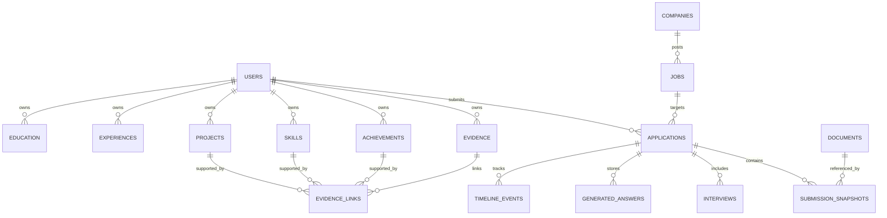

# CareerOS Database Schema

Version: 0.1 Draft

Status: In Progress

Last Updated: July 2026

---

# Purpose

This document defines the complete relational database schema for CareerOS.

It is the authoritative reference for:

- PostgreSQL schema
- SQLAlchemy ORM models
- Alembic migrations
- API contracts
- Backend validation
- AI retrieval
- Analytics
- Future integrations

The goal is that no developer should need to guess how data should be stored.

Every entity, relationship, constraint, and lifecycle should be defined here before implementation.

---

# Guiding Principles

The database is not designed around resumes.

It is designed around career knowledge.

Documents are generated from knowledge.

Knowledge is supported by evidence.

Applications preserve historical snapshots.

CareerOS remembers facts—not files.

---

# Database Philosophy

CareerOS stores three categories of information.

## 1. Canonical Knowledge

Canonical knowledge represents the user's current professional profile.

Examples include:

- Education
- Experiences
- Projects
- Skills
- Achievements
- Career Preferences

Canonical knowledge is editable.

If the user updates a project description, the canonical project changes.

Future resumes should reflect the newest information.

---

## 2. Historical Records

Historical records preserve what actually happened.

Examples include:

- Submitted resumes
- Submitted cover letters
- Application answers
- Job descriptions
- Recruiter communications
- Interview notes

Historical records are immutable.

Once an application has been submitted, CareerOS should always be able to reconstruct exactly what the user submitted.

---

## 3. Learning Data

Learning data allows CareerOS to improve recommendations over time.

Examples include:

- Outcomes
- Interview questions
- Reflection notes
- Recruiter feedback
- Application success rates
- Resume performance

Learning data is append-only whenever possible.

Nothing should overwrite historical recruiting outcomes.

---

# Database Technology

Version 1 uses:

Database Engine:

PostgreSQL

ORM:

SQLAlchemy

Migration Framework:

Alembic

Vector Search:

pgvector (future)

Full Text Search:

PostgreSQL Full Text Search

JSON Support:

JSONB

UUID Support:

Native PostgreSQL UUID

---

# Naming Conventions

All tables use:

snake_case

Examples

users

education

experiences

resume_versions

application_timeline_events

---

Columns also use snake_case.

Example

first_name

graduation_date

created_at

updated_at

deleted_at

resume_version_id

---

Primary Keys

Every table shall contain:

id UUID PRIMARY KEY

UUIDs prevent enumeration attacks and simplify future synchronization between services.

Version 7 UUIDs are preferred when available.

---

Foreign Keys

Foreign keys shall follow this convention:

user_id

application_id

company_id

job_id

experience_id

project_id

resume_version_id

No abbreviations should be used.

---

Timestamps

Every mutable entity shall contain:

created_at

updated_at

All timestamps use:

TIMESTAMP WITH TIME ZONE

UTC only.

The frontend is responsible for localization.

---

Soft Deletes

CareerOS should almost never permanently delete information.

Instead, entities should support:

deleted_at

NULL indicates active.

Timestamp indicates archived.

Deleted records should not appear in normal queries.

Historical snapshots continue referencing archived records.

---

Audit Fields

Most editable tables should include:

created_by

updated_by

created_at

updated_at

deleted_at

This supports future collaboration without changing the schema.

---

Ownership

Every user-owned entity shall contain:

user_id

Examples

Projects

Experiences

Applications

Contacts

Achievements

Skills

Evidence

Timeline Events

Future multi-user support should require minimal schema changes.

---

Versioning Strategy

CareerOS distinguishes between editable knowledge and immutable history.

Editable objects include:

Experience

Project

Achievement

Skill

Education

Historical objects include:

Submission

Resume Version

Cover Letter Version

Application Snapshot

Generated Answers

Interview Notes

Historical objects should never be modified after creation.

Corrections should create new versions.

---

Evidence First

One of the core principles of CareerOS is that every important claim should be supported by evidence.

Evidence is treated as its own domain object rather than embedded inside experiences or projects.

Examples of evidence include:

Conference presentation

GitHub repository

Publication

Performance review

Transcript

Certificate

Research paper

Award letter

Recommendation

Portfolio item

Screenshot

Future AI generation should cite evidence rather than simply trusting free-text descriptions.

---

Data Integrity

The database should enforce correctness whenever possible.

Examples include:

No application without a job.

No experience without an owner.

No submission without an application.

No resume version without evidence references.

Business rules belong in the backend whenever they require workflow knowledge.

Structural correctness belongs in the database.

---

Security Philosophy

The database stores highly sensitive professional information.

Every design decision should assume the data includes:

Personal identity

Addresses

Employment history

Education

Salary expectations

Work authorization

Recruiter communications

Interview notes

Private reflections

CareerOS should therefore minimize unnecessary duplication of personally identifiable information.

Sensitive data should exist in one canonical location whenever possible.

---

Entity Categories

The database is organized into logical domains.

## User Domain

Stores long-term user identity.

Examples:

User

Preferences

Authentication Mapping

Settings

---

## Career Knowledge Domain

Stores canonical professional knowledge.

Examples:

Education

Experience

Project

Skill

Achievement

Certification (future)

Publication (future)

---

## Recruiting Domain

Stores recruiting-specific information.

Examples:

Company

Job

Application

Submission

Recruiter

Interview

Assessment

Offer

---

## Document Domain

Stores generated artifacts.

Examples:

Resume Version

Cover Letter Version

Generated Answer

Generated Summary

---

## Evidence Domain

Stores supporting proof for professional claims.

Examples:

GitHub Repository

Presentation

Research Paper

Transcript

Award

Recommendation

Portfolio Item

---

## Timeline Domain

Stores chronological events.

Examples:

Application Submitted

Interview Scheduled

Offer Received

Rejection

Networking Conversation

Certification Earned

Resume Updated

---

## Analytics Domain

Stores calculated insights.

Examples:

Fit Scores

Application Success Metrics

Resume Performance

Interview Statistics

Recommendation History

These objects should remain reproducible from historical data whenever possible.

---

# High-Level Entity Relationship

CareerOS revolves around a single user.

The user owns canonical knowledge.

Canonical knowledge generates documents.

Documents are submitted through applications.

Applications generate outcomes.

Outcomes produce learning.

Learning improves future recommendations.

Conceptually:

User

↓

Career Knowledge

↓

Evidence

↓

Generated Documents

↓

Applications

↓

Timeline

↓

Outcomes

↓

Analytics

↓

Future Recommendations

---

# Database Design Goals

The schema should satisfy the following goals:

- Highly normalized where appropriate
- Easy to query
- Explainable AI outputs
- Minimal data duplication
- Historical reconstruction
- Future multi-user support
- Future collaboration
- Incremental migrations
- Long-term maintainability

Optimization should never come at the cost of losing historical correctness.

---

# Next Section

The following section defines the first database tables:

- users
- user_preferences
- education
- experiences
- projects
- achievements
- skills

Each table will specify:

- Purpose
- Columns
- Data types
- Constraints
- Relationships
- Indexes
- Lifecycle
- Future expansion

erDiagram
    USERS ||--o{ EXPERIENCES : owns
    USERS ||--o{ PROJECTS : owns
    USERS ||--o{ APPLICATIONS : submits
    APPLICATIONS ||--|| JOBS : targets
    APPLICATIONS ||--o{ SUBMISSIONS : contains
    EXPERIENCES ||--o{ EVIDENCE : supported_by

---

# User Domain

The User Domain stores the canonical owner of all career knowledge.

Every other user-owned entity ultimately references the `users` table.

---

# Table: users

## Purpose

Stores the primary CareerOS account.

This table represents the owner of all career knowledge.

It intentionally contains only long-lived identity information.

Authentication credentials are delegated to the authentication provider (Clerk).

---

## Columns

| Column | Type | Required | Description |
|---------|------|----------|-------------|
| id | UUID | Yes | Primary key |
| clerk_user_id | TEXT | Yes | External authentication identifier |
| email | TEXT | Yes | Primary email address |
| first_name | TEXT | Yes | Legal or preferred first name |
| last_name | TEXT | Yes | Legal or preferred last name |
| phone_number | TEXT | No | Optional contact number |
| timezone | TEXT | Yes | User timezone |
| created_at | TIMESTAMP WITH TIME ZONE | Yes | Record creation |
| updated_at | TIMESTAMP WITH TIME ZONE | Yes | Last modification |
| deleted_at | TIMESTAMP WITH TIME ZONE | No | Soft delete timestamp |

---

## Constraints

Primary Key

```sql
PRIMARY KEY (id)
```

Unique

```sql
UNIQUE(email)
UNIQUE(clerk_user_id)
```

---

## Relationships

One User owns:

- Many Education records
- Many Experiences
- Many Projects
- Many Skills
- Many Achievements
- Many Applications
- Many Contacts
- Many Timeline Events
- Many Evidence records

---

## Indexes

```sql
INDEX(email)

INDEX(clerk_user_id)
```

---

## Lifecycle

Editable

Soft deletable

Never physically deleted unless required by explicit account deletion.

---

# Table: user_preferences

## Purpose

Stores personalized career preferences.

These values guide AI recommendations and application filtering.

Preferences should never overwrite historical applications.

Applications preserve snapshots.

---

## Columns

| Column | Type |
|---------|------|
| id | UUID |
| user_id | UUID |
| preferred_roles | JSONB |
| preferred_locations | JSONB |
| salary_expectation_min | INTEGER |
| salary_expectation_max | INTEGER |
| work_authorization | TEXT |
| sponsorship_required | BOOLEAN |
| remote_preference | TEXT |
| relocation_preference | BOOLEAN |
| resume_template | TEXT |
| created_at | TIMESTAMP |
| updated_at | TIMESTAMP |

---

## Relationships

One User

↓

One Preference Profile

---

## Future Expansion

Eventually preferences may include:

- Industries

- Company sizes

- Startup preference

- Public vs Private

- Travel willingness

- AI recommendation settings

---

# Career Knowledge Domain

Career knowledge represents the user's editable professional profile.

Unlike submissions,

career knowledge evolves.

---

# Table: education

## Purpose

Stores every educational institution attended.

CareerOS intentionally stores education separately from resumes.

Multiple resumes may display different subsets.

---

## Columns

| Column | Type |
|---------|------|
| id | UUID |
| user_id | UUID |
| institution_name | TEXT |
| institution_type | TEXT |
| degree | TEXT |
| major | TEXT |
| minor | TEXT |
| concentration | TEXT |
| gpa | DECIMAL(3,2) |
| start_date | DATE |
| graduation_date | DATE |
| graduation_status | TEXT |
| honors | JSONB |
| scholarships | JSONB |
| coursework | JSONB |
| created_at | TIMESTAMP |
| updated_at | TIMESTAMP |
| deleted_at | TIMESTAMP |

---

## Relationships

User

↓

Education

↓

Coursework

↓

Projects

---

## Future Expansion

Future versions may normalize:

Coursework

Scholarships

Awards

Departments

Faculty

---

# Table: experiences

## Purpose

Represents employment,

research,

teaching,

internships,

leadership,

and volunteer experience.

Everything is modeled uniformly.

The experience type distinguishes categories.

---

## Columns

| Column | Type |
|---------|------|
| id | UUID |
| user_id | UUID |
| experience_type | ENUM |
| organization_name | TEXT |
| title | TEXT |
| location | TEXT |
| start_date | DATE |
| end_date | DATE |
| current_position | BOOLEAN |
| description | TEXT |
| created_at | TIMESTAMP |
| updated_at | TIMESTAMP |
| deleted_at | TIMESTAMP |

---

## Relationships

Experience

↓

Projects

↓

Evidence

↓

Skills

↓

Achievements

---

## Future Expansion

Future versions may attach:

Manager

Compensation

Performance Reviews

Offer Letters

Employment Verification

---

# Experience Type Enum

```text
INTERNSHIP

FULL_TIME

PART_TIME

RESEARCH

TEACHING

VOLUNTEER

LEADERSHIP

FREELANCE

SELF_EMPLOYED

OTHER
```

---

# Indexes

```sql
INDEX(user_id)

INDEX(experience_type)

INDEX(start_date)

INDEX(end_date)
```

---

# Table: projects

## Purpose

Projects represent the strongest evidence of technical ability.

Projects may belong to:

Experience

Education

Personal Work

Hackathons

Research

Independent Learning

---

## Columns

| Column | Type |
|---------|------|
| id | UUID |
| user_id | UUID |
| experience_id | UUID NULL |
| title | TEXT |
| description | TEXT |
| outcome | TEXT |
| github_url | TEXT |
| demo_url | TEXT |
| documentation_url | TEXT |
| start_date | DATE |
| end_date | DATE |
| created_at | TIMESTAMP |
| updated_at | TIMESTAMP |

---

## Relationships

Project

↓

Evidence

↓

Skills

↓

Resume Bullets

↓

Applications

---

# Design Philosophy

Projects should remain independent.

The same project may appear in:

Five resumes

Three cover letters

Two applications

without duplication.

---

# Next Section

Part 3 continues with:

- achievements
- skills
- evidence
- companies
- jobs

---

# Table: achievements

## Purpose

Represents measurable accomplishments throughout the user's career.

Unlike experiences, achievements are atomic accomplishments that may be referenced independently.

Examples include:

- Awards
- Scholarships
- Promotions
- Conference presentations
- Publications
- Leadership milestones
- Competition placements
- Organizational growth
- Revenue generated
- Members recruited

Achievements should always reference supporting evidence whenever possible.

---

## Columns

| Column | Type |
|---------|------|
| id | UUID |
| user_id | UUID |
| experience_id | UUID NULL |
| project_id | UUID NULL |
| title | TEXT |
| category | ENUM |
| description | TEXT |
| metric | TEXT |
| achieved_on | DATE |
| created_at | TIMESTAMP |
| updated_at | TIMESTAMP |
| deleted_at | TIMESTAMP |

---

## Achievement Categories

```text
ACADEMIC

PROFESSIONAL

RESEARCH

LEADERSHIP

VOLUNTEER

COMPETITION

CERTIFICATION

PUBLICATION

SCHOLARSHIP

OTHER
```

---

## Relationships

Achievement

↓

Evidence

↓

Applications

↓

Resume Bullet Generation

---

# Table: skills

## Purpose

Represents professional capabilities.

Skills should never exist as isolated keywords.

Every skill should be supported by one or more pieces of evidence.

CareerOS should eventually calculate confidence scores for every skill.

---

## Columns

| Column | Type |
|---------|------|
| id | UUID |
| user_id | UUID |
| name | TEXT |
| category | ENUM |
| proficiency_level | ENUM |
| years_experience | DECIMAL |
| confidence_score | DECIMAL |
| verified | BOOLEAN |
| created_at | TIMESTAMP |
| updated_at | TIMESTAMP |

---

## Skill Categories

```text
PROGRAMMING

DATA_ANALYTICS

MACHINE_LEARNING

AI

DATABASE

VISUALIZATION

SOFTWARE

CLOUD

MATHEMATICS

COMMUNICATION

LEADERSHIP

PROJECT_MANAGEMENT

LANGUAGE

OTHER
```

---

## Proficiency Levels

```text
BEGINNER

INTERMEDIATE

ADVANCED

EXPERT
```

---

## Design Philosophy

CareerOS should never assume a skill simply because it appears on a resume.

Instead:

Skill

↓

Evidence

↓

Confidence

↓

Recommendation

This allows explainable AI recommendations.

---

# Table: evidence

## Purpose

Evidence is one of the most important entities in CareerOS.

Every meaningful professional claim should be traceable to evidence.

Evidence is intentionally separated from experiences and projects so that multiple objects may reference the same proof.

---

## Columns

| Column | Type |
|---------|------|
| id | UUID |
| user_id | UUID |
| evidence_type | ENUM |
| title | TEXT |
| description | TEXT |
| source_url | TEXT |
| file_reference | TEXT |
| verification_status | ENUM |
| date_created | DATE |
| created_at | TIMESTAMP |
| updated_at | TIMESTAMP |

---

## Evidence Types

```text
GITHUB

PUBLICATION

RESEARCH

CERTIFICATE

AWARD

TRANSCRIPT

PRESENTATION

SCREENSHOT

PORTFOLIO

VIDEO

LETTER_OF_RECOMMENDATION

PERFORMANCE_REVIEW

OTHER
```

---

## Verification Status

```text
UNVERIFIED

SELF_VERIFIED

PEER_VERIFIED

OFFICIALLY_VERIFIED
```

---

## Relationships

Evidence may support:

- Experiences
- Projects
- Skills
- Achievements
- Resume Bullets
- Cover Letter Statements
- Interview Answers

Evidence is many-to-many.

---

# Junction Table: evidence_links

## Purpose

Connects evidence to any supported entity.

Rather than storing many foreign keys inside the evidence table, CareerOS stores generalized links.

---

## Columns

| Column | Type |
|---------|------|
| id | UUID |
| evidence_id | UUID |
| entity_type | ENUM |
| entity_id | UUID |
| relationship_type | TEXT |

---

## Example

GitHub Repository

↓

Project

↓

Python Skill

↓

Resume Bullet

↓

Application

The same repository should never need to be uploaded twice.

---

# Recruiting Domain

Recruiting information is intentionally separated from canonical career knowledge.

Career knowledge belongs to the user.

Recruiting information belongs to opportunities.

---

# Table: companies

## Purpose

Represents organizations with which the user interacts.

Companies persist across multiple job postings and applications.

---

## Columns

| Column | Type |
|---------|------|
| id | UUID |
| name | TEXT |
| website | TEXT |
| industry | TEXT |
| headquarters | TEXT |
| sponsorship_available | BOOLEAN |
| notes | TEXT |
| created_at | TIMESTAMP |
| updated_at | TIMESTAMP |

---

## Relationships

Company

↓

Jobs

↓

Applications

↓

Recruiters

---

# Table: jobs

## Purpose

Represents an individual job posting.

Jobs are immutable once imported.

If a posting changes online,

CareerOS creates a new version rather than modifying history.

---

## Columns

| Column | Type |
|---------|------|
| id | UUID |
| company_id | UUID |
| title | TEXT |
| department | TEXT |
| employment_type | ENUM |
| location | TEXT |
| remote_type | ENUM |
| salary_min | INTEGER |
| salary_max | INTEGER |
| description | TEXT |
| requirements | TEXT |
| preferred_qualifications | TEXT |
| application_deadline | DATE |
| posting_url | TEXT |
| imported_at | TIMESTAMP |

---

## Employment Types

```text
FULL_TIME

PART_TIME

INTERNSHIP

CONTRACT

TEMPORARY

RESEARCH

OTHER
```

---

## Remote Types

```text
ONSITE

HYBRID

REMOTE
```

---

## Relationships

Job

↓

Applications

↓

Resume Versions

↓

Cover Letters

↓

Generated Answers

---

## Design Philosophy

A Job is a historical document.

CareerOS should preserve exactly what was advertised at the time of application.

Future edits to the company's website should never overwrite historical postings.

---

# Entity Relationship Overview

Career Knowledge

↓

Projects

↓

Evidence

↓

Skills

↓

Achievements

↓

Resume Generation

↓

Job Posting

↓

Application

↓

Submission Snapshot

↓

Timeline

↓

Outcome

↓

Analytics

---

# Next Section

Part 4 defines the heart of CareerOS:

- Applications
- Submission Snapshots
- Resume Versions
- Cover Letter Versions
- Generated Answers
- Timeline Events
- Interview Records
- Offer Tracking

This section establishes how CareerOS preserves history while continuing to learn from every application.

---

# Historical Document Domain

CareerOS generates many professional artifacts.

Rather than creating separate storage systems for resumes, cover letters, networking messages, and future document types, CareerOS treats every generated artifact as a document.

Documents are immutable historical records.

Each document represents exactly what the user reviewed and approved at a specific point in time.

Documents should never be modified after creation.

Instead, newer versions are generated.

---

# Table: documents

## Purpose

Represents every AI-generated or user-authored professional document.

Document types include:

- Resume
- Cover Letter
- Networking Message
- Recruiter Message
- Thank You Email
- Interview Preparation
- Application Response
- Career Summary
- Portfolio Summary

Future document types should require no schema changes.

---

## Columns

| Column | Type |
|---------|------|
| id | UUID |
| user_id | UUID |
| document_type | ENUM |
| version_number | INTEGER |
| title | TEXT |
| generated_content | TEXT |
| exported_pdf_path | TEXT |
| exported_docx_path | TEXT |
| ai_prompt_version | TEXT |
| approved_by_user | BOOLEAN |
| created_at | TIMESTAMP |

---

## Document Types

```text
RESUME

COVER_LETTER

APPLICATION_RESPONSE

THANK_YOU_EMAIL

FOLLOW_UP_EMAIL

NETWORKING_MESSAGE

RECRUITER_MESSAGE

INTERVIEW_PREPARATION

CAREER_SUMMARY

OTHER
```

---

## Relationships

Document

↓

Evidence

↓

Application

↓

Export History

---

## Design Philosophy

CareerOS stores professional documents.

CareerOS does not store resumes.

A resume is simply one kind of document.

---

# Table: applications

## Purpose

Applications are the central workflow object within CareerOS.

Every application represents one hiring opportunity.

Applications evolve over time.

Unlike submission snapshots,

Applications are mutable.

---

## Columns

| Column | Type |
|---------|------|
| id | UUID |
| user_id | UUID |
| job_id | UUID |
| current_status | ENUM |
| recruiter_contact_id | UUID NULL |
| applied_on | DATE |
| last_activity_at | TIMESTAMP |
| archived | BOOLEAN |
| created_at | TIMESTAMP |
| updated_at | TIMESTAMP |

---

## Application Status

```text
DRAFT

READY_TO_APPLY

SUBMITTED

ASSESSMENT

INTERVIEW

FINAL_ROUND

OFFER

ACCEPTED

REJECTED

WITHDRAWN

ARCHIVED
```

---

## Relationships

Application

↓

Submission Snapshots

↓

Timeline Events

↓

Interview Records

↓

Documents

↓

Analytics

---

# Table: submission_snapshots

## Purpose

Represents exactly what was submitted.

Submission snapshots are immutable.

They preserve:

- Resume

- Cover Letter

- Generated Answers

- Job Description

- Timestamp

Nothing inside a snapshot may be modified.

---

## Columns

| Column | Type |
|---------|------|
| id | UUID |
| application_id | UUID |
| resume_document_id | UUID |
| cover_letter_document_id | UUID NULL |
| submitted_job_description | TEXT |
| submitted_at | TIMESTAMP |
| created_at | TIMESTAMP |

---

## Relationships

Application

↓

Submission Snapshot

↓

Historical Reconstruction

---

## Design Philosophy

CareerOS should always answer:

"What exactly did I submit?"

without relying on editable knowledge.

---

# Table: generated_answers

## Purpose

Stores AI-generated application responses.

Examples:

- Why do you want to work here?

- Describe a challenge.

- Tell us about yourself.

Every generated answer references supporting evidence.

---

## Columns

| Column | Type |
|---------|------|
| id | UUID |
| application_id | UUID |
| question | TEXT |
| generated_answer | TEXT |
| evidence_summary | TEXT |
| confidence_score | DECIMAL |
| approved | BOOLEAN |
| created_at | TIMESTAMP |

---

## Relationships

Generated Answer

↓

Evidence

↓

Application

↓

Submission Snapshot

---

# Table: interviews

## Purpose

Stores interview stages.

Applications may contain multiple interviews.

Examples:

- Phone Screen

- Technical Interview

- Hiring Manager

- Panel Interview

- Final Round

---

## Columns

| Column | Type |
|---------|------|
| id | UUID |
| application_id | UUID |
| interview_stage | ENUM |
| interviewer_name | TEXT |
| interview_date | TIMESTAMP |
| duration_minutes | INTEGER |
| notes | TEXT |
| outcome | TEXT |
| created_at | TIMESTAMP |

---

## Interview Stages

```text
PHONE_SCREEN

TECHNICAL

BEHAVIORAL

MANAGER

PANEL

ONSITE

FINAL

OTHER
```

---

# Table: interview_questions

## Purpose

Stores every interview question.

CareerOS learns from previous interviews.

Future interview preparation references this knowledge.

---

## Columns

| Column | Type |
|---------|------|
| id | UUID |
| interview_id | UUID |
| question | TEXT |
| answer_given | TEXT |
| confidence | DECIMAL |
| notes | TEXT |

---

# Table: offers

## Purpose

Represents employment offers.

Applications may receive zero or one offer.

---

## Columns

| Column | Type |
|---------|------|
| id | UUID |
| application_id | UUID |
| salary | INTEGER |
| signing_bonus | INTEGER |
| relocation_bonus | INTEGER |
| equity | TEXT |
| offer_date | DATE |
| accepted | BOOLEAN |
| notes | TEXT |

---

# Timeline Domain

CareerOS should reconstruct the user's professional journey.

Every significant event becomes a timeline event.

---

# Table: timeline_events

## Purpose

Stores chronological career history.

Timeline events should be append-only.

Events are never edited.

Corrections create new events.

---

## Columns

| Column | Type |
|---------|------|
| id | UUID |
| application_id | UUID NULL |
| event_type | ENUM |
| title | TEXT |
| description | TEXT |
| occurred_at | TIMESTAMP |
| created_at | TIMESTAMP |

---

## Event Types

```text
APPLICATION_CREATED

APPLICATION_SUBMITTED

ASSESSMENT_RECEIVED

INTERVIEW_SCHEDULED

INTERVIEW_COMPLETED

OFFER_RECEIVED

OFFER_ACCEPTED

REJECTION_RECEIVED

NETWORKING_EVENT

DOCUMENT_GENERATED

DOCUMENT_APPROVED

SKILL_ADDED

PROJECT_CREATED

CERTIFICATION_EARNED

OTHER
```

---

# Historical Reconstruction

One of CareerOS's primary goals is historical accuracy.

At any point in the future,

CareerOS should reconstruct:

- The original job posting

- The submitted resume

- The submitted cover letter

- Every generated answer

- Timeline events

- Interview notes

- Offer details

- Reflection

without relying on mutable canonical knowledge.

Historical truth should always remain reproducible.

---

# Next Section

Part 5 completes the database specification by defining:

- Indexing strategy
- Performance optimization
- Naming standards
- Cascade rules
- Migration philosophy
- Future tables
- Entity Relationship diagrams
- Scalability strategy

---

# Part 5 — Database Standards, Performance & Future Expansion

# Indexing Strategy

Indexes should be created only when they improve common application queries.

Every index introduces additional storage and write overhead.

Indexes should therefore be intentional rather than automatic.

---

## Primary Key Indexes

Every table includes:

```sql
PRIMARY KEY(id)
```

No exceptions.

---

## Foreign Key Indexes

Every foreign key should also receive an index.

Examples:

```sql
INDEX(user_id)

INDEX(application_id)

INDEX(job_id)

INDEX(company_id)

INDEX(project_id)

INDEX(experience_id)
```

These indexes dramatically improve join performance.

---

## Composite Indexes

Frequently queried combinations should receive composite indexes.

Examples include:

Applications

```sql
(user_id, current_status)
```

Timeline

```sql
(application_id, occurred_at)
```

Projects

```sql
(user_id, start_date)
```

Documents

```sql
(user_id, document_type)
```

Jobs

```sql
(company_id, employment_type)
```

---

## Full Text Search

The following tables should eventually support PostgreSQL Full Text Search.

- jobs
- projects
- experiences
- achievements
- documents

This enables natural searching such as

"machine learning"

"quantitative finance"

"python"

"research"

without relying entirely on AI.

---

## Vector Search

Future versions will enable semantic search using pgvector.

Candidate embeddings include:

Projects

Experiences

Evidence

Generated Documents

Job Descriptions

Resume Sections

This enables similarity search without changing the relational schema.

---

# Cascade Rules

CareerOS intentionally minimizes cascading deletes.

Deleting historical data should be extremely rare.

Preferred behavior:

DELETE

↓

Soft Delete

↓

Archive

↓

Retain History

---

## Example

Deleting a project should never automatically delete

Evidence

Applications

Resume Versions

Timeline Events

Historical records should always remain reproducible.

---

# Soft Delete Policy

Entities supporting soft deletion include:

- Education
- Experiences
- Projects
- Achievements
- Skills
- Contacts
- Companies

Historical entities should never be soft deleted.

Examples:

Submission Snapshots

Timeline Events

Generated Documents

Interview Records

These become permanent historical records.

---

# Audit Strategy

Every mutable table should include:

created_at

updated_at

deleted_at

Future enterprise versions may additionally include

created_by

updated_by

deleted_by

reason_for_change

This enables complete auditability.

---

# Data Validation

Database constraints should enforce structural correctness.

Examples include:

Valid foreign keys

Unique authentication identifiers

Required ownership

Non-null required fields

Business rules remain inside backend services.

Example:

Application status transitions

Offer acceptance workflow

Interview scheduling

These should not be implemented as database constraints.

---

# Performance Goals

Version 1 targets

Less than

100,000

records per user.

Expected workload

Thousands of applications

Thousands of projects

Thousands of documents

Hundreds of interviews

Millions of timeline events across all users.

The schema should comfortably support this scale.

---

# Migration Philosophy

Schema evolution should be additive whenever possible.

Preferred order:

Add column

↓

Populate

↓

Deploy

↓

Deprecate old column

↓

Remove later

Avoid destructive migrations.

Every migration should support rollback.

Alembic becomes the authoritative migration history.

---

# Backup Strategy

CareerOS stores valuable professional history.

Recommended backup schedule

Daily incremental backups

Weekly full backups

Monthly archive snapshots

Backups should be encrypted.

Recovery testing should occur regularly.

---

# Future Expansion

The schema intentionally leaves room for future entities.

Examples include:

Publications

Patents

Courses

Organizations

Networking Events

Recruiting Campaigns

Salary Negotiations

Offer Comparisons

AI Recommendations

Career Goals

Career Plans

Learning Plans

Mentorship Relationships

Certifications

Portfolio Websites

Blog Posts

Research Papers

Volunteer Organizations

Future entities should integrate without redesigning existing tables.

---

# Scalability

CareerOS begins as

One Backend

↓

One PostgreSQL Database

↓

One User

Eventually

Multiple Users

↓

Organizations

↓

Shared Knowledge

↓

Recruiters

↓

Enterprise Features

The current schema should support this evolution without major redesign.

---

# Entity Relationship Diagram



---

# Database Principles Summary

CareerOS should always prioritize

Correctness

↓

Historical Accuracy

↓

Explainability

↓

Maintainability

↓

Performance

↓

Optimization

Optimization should never compromise historical truth.

---

# Completion Criteria

The database specification is considered complete when

✓ Every entity is documented

✓ Every relationship is defined

✓ Every lifecycle is specified

✓ Versioning strategy is documented

✓ Naming conventions are established

✓ Migration philosophy is defined

✓ Scalability considerations are documented

✓ Future expansion points are identified

This document becomes the authoritative specification for:

- SQLAlchemy models
- Alembic migrations
- PostgreSQL schema
- Backend APIs
- AI retrieval
- Analytics
- Future integrations

---

# Guiding Principle

CareerOS is not a database of resumes.

CareerOS is a structured memory of a person's professional life.

Everything else—including resumes, cover letters, interview preparation, networking messages, and future AI recommendations—is generated from that memory.
