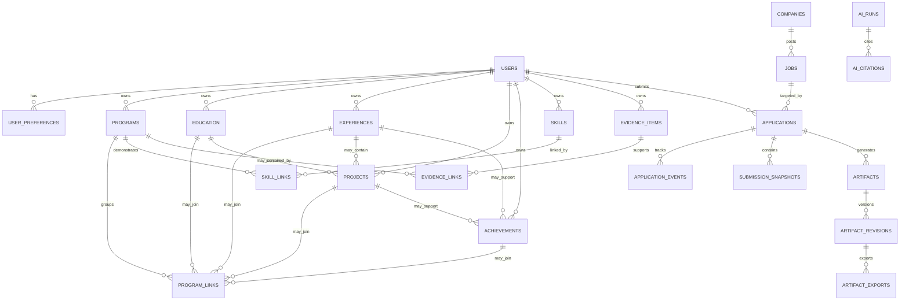

# CareerOS Database Schema

> Version: Draft 1.0  
> Status: Implementation Specification  
> Last Updated: July 2026

---

## 1. Purpose

This document defines the relational database schema for CareerOS.

It is the authoritative reference for:

- PostgreSQL schema design
- SQLAlchemy ORM models
- Alembic migrations
- API contracts
- backend validation
- evidence-backed AI retrieval
- application analytics
- future integrations

The goal is simple: no developer, AI agent, or future contributor should need to guess how CareerOS stores career knowledge.

CareerOS is not a resume database. CareerOS is a structured memory system for a person's professional life.

---

## 2. Core Database Philosophy

CareerOS stores three kinds of information.

### 2.1 Canonical Career Knowledge

Canonical knowledge is the user's current professional profile.

Examples:

- programs
- education
- experiences
- projects
- achievements
- skills
- preferences
- contacts

Canonical knowledge is editable. If the user improves a project description, future documents should use the improved version.

### 2.2 Historical Snapshots

Historical snapshots preserve exactly what happened at a specific point in time.

Examples:

- submitted resumes
- submitted cover letters
- submitted application answers
- imported job descriptions
- interview notes
- offer details

Historical snapshots are immutable. Editing a project later must never change what was submitted to a company earlier.

### 2.3 Learning Data

Learning data helps CareerOS improve recommendations over time.

Examples:

- outcomes
- rejection reasons
- interview questions
- reflections
- recruiter feedback
- application timeline events

Learning data should be append-only whenever possible.

---

## 3. Technology Assumptions

CareerOS uses:

| Layer | Technology |
|---|---|
| Database | PostgreSQL |
| ORM | SQLAlchemy |
| Migrations | Alembic |
| API | FastAPI |
| IDs | UUID |
| JSON fields | JSONB |
| Future vector search | pgvector |
| Future text search | PostgreSQL full-text search |

---

## 4. Global Schema Standards

### 4.1 Primary Keys

Every table uses:

```sql
id UUID PRIMARY KEY
```

UUIDs are preferred because they:

- avoid predictable IDs
- simplify future distributed systems
- work well across local and cloud environments
- avoid leaking record counts

### 4.2 User Ownership

Every tenant-owned table must include:

```sql
user_id UUID NOT NULL REFERENCES users(id)
```

This includes career knowledge, applications, documents, evidence, and timeline records.

### 4.3 Timestamps

Mutable tables include:

```sql
created_at TIMESTAMPTZ NOT NULL
updated_at TIMESTAMPTZ NOT NULL
deleted_at TIMESTAMPTZ NULL
```

Historical append-only tables include:

```sql
created_at TIMESTAMPTZ NOT NULL
```

Timeline-style tables should also include:

```sql
occurred_at TIMESTAMPTZ NOT NULL
recorded_at TIMESTAMPTZ NOT NULL
```

`occurred_at` means when the event happened.  
`recorded_at` means when CareerOS learned about it.

### 4.4 Soft Deletes

Canonical knowledge should usually be soft deleted.

Historical submissions, generated document revisions, audit events, and timeline events should not be soft deleted during normal use.

Account deletion and legal deletion requirements are handled by a future data deletion workflow.

### 4.5 Naming Conventions

Tables use plural snake_case:

- users
- experiences
- projects
- application_events

Columns use snake_case:

- user_id
- created_at
- current_status
- imported_at

Enum values use uppercase snake case:

- FULL_TIME
- INTERNSHIP
- SUBMITTED
- REJECTED

---

## 5. Entity Overview

### User Domain

- users
- user_preferences

### Career Knowledge Domain

- programs
- program_links
- education
- experiences
- projects
- achievements
- skills
- skill_links

### Evidence Domain

- evidence_items
- evidence_links

### Recruiting Domain

- companies
- jobs
- contacts
- applications
- application_events
- interviews
- interview_questions
- offers
- reflections

### Document Domain

- artifacts
- artifact_revisions
- artifact_exports
- generated_answers
- submission_snapshots

### AI Provenance Domain

- ai_runs
- ai_citations
- prompt_templates

---

## 6. User Domain

## 6.1 Table: users

### Purpose

Stores the internal CareerOS user record.

Authentication credentials are delegated to Clerk or a future authentication provider. The external provider ID is stored, but it is not the primary key.

### Columns

| Column | Type | Required | Notes |
|---|---:|---:|---|
| id | UUID | Yes | Primary key |
| clerk_user_id | TEXT | Yes | Unique external auth subject |
| email | TEXT | Yes | Unique primary email |
| first_name | TEXT | No | Preferred or legal first name |
| last_name | TEXT | No | Preferred or legal last name |
| display_name | TEXT | No | Optional public-facing name |
| timezone | TEXT | Yes | Default `America/Chicago` for initial user |
| created_at | TIMESTAMPTZ | Yes | Creation timestamp |
| updated_at | TIMESTAMPTZ | Yes | Last update timestamp |
| deleted_at | TIMESTAMPTZ | No | Soft delete |

### Constraints

```sql
PRIMARY KEY (id);
UNIQUE (clerk_user_id);
UNIQUE (email);
```

### Indexes

```sql
CREATE INDEX idx_users_email ON users(email);
CREATE INDEX idx_users_clerk_user_id ON users(clerk_user_id);
```

---

## 6.2 Table: user_preferences

### Purpose

Stores user preferences that guide job filtering, document generation, and recommendations.

Preferences are editable and should not rewrite historical applications.

### Columns

| Column | Type | Required | Notes |
|---|---:|---:|---|
| id | UUID | Yes | Primary key |
| user_id | UUID | Yes | FK users.id |
| preferred_roles | JSONB | No | Array of roles |
| preferred_industries | JSONB | No | Array of industries |
| preferred_locations | JSONB | No | Array of cities/regions |
| remote_preference | TEXT | No | ONSITE, HYBRID, REMOTE, FLEXIBLE |
| work_authorization | TEXT | No | User-provided authorization status |
| sponsorship_required | BOOLEAN | No | Whether sponsorship is required |
| target_salary_min | INTEGER | No | Annual salary expectation |
| target_salary_max | INTEGER | No | Annual salary expectation |
| resume_style | TEXT | No | Preferred resume style |
| created_at | TIMESTAMPTZ | Yes | Creation timestamp |
| updated_at | TIMESTAMPTZ | Yes | Last update timestamp |

### Constraints

```sql
UNIQUE (user_id);
```

---

## 7. Career Knowledge Domain

## 7.1 Table: programs

### Purpose

Stores first-class Programs: structured experiences that may span academic, research, leadership, professional development, and entrepreneurial categories.

A Program groups related canonical knowledge without duplicating the underlying Education, Experience, Project, Achievement, Skill, or Evidence records.

Examples include:

- Galaxy Evolution Vertically Integrated Program (GEVIP)
- Nash Leaders Program
- Honors Program
- NSF REU
- Leadership Cohorts
- Startup Accelerators

### Columns

| Column | Type | Required | Notes |
|---|---:|---:|---|
| id | UUID | Yes | Primary key |
| user_id | UUID | Yes | FK users.id |
| name | TEXT | Yes | Program name |
| organization_name | TEXT | No | Sponsoring institution or organization |
| summary | TEXT | No | Program purpose and participation summary |
| categories | JSONB | No | Array such as RESEARCH, LEADERSHIP, HONORS |
| start_date | DATE | No | Start date |
| end_date | DATE | No | End date |
| date_precision | TEXT | No | DAY, MONTH, YEAR, UNKNOWN |
| is_current | BOOLEAN | Yes | Default false |
| program_url | TEXT | No | Official or supporting URL |
| created_at | TIMESTAMPTZ | Yes | Creation timestamp |
| updated_at | TIMESTAMPTZ | Yes | Last update |
| deleted_at | TIMESTAMPTZ | No | Soft delete |

### Relationships

| Related Entity | Cardinality | Implementation |
|---|---|---|
| users | Many Programs to one User | `programs.user_id` FK |
| education | Many-to-many | `program_links` with `entity_type = EDUCATION` |
| experiences | Many-to-many | `program_links` with `entity_type = EXPERIENCE` |
| projects | Many-to-many | `program_links` with `entity_type = PROJECT` |
| achievements | Many-to-many | `program_links` with `entity_type = ACHIEVEMENT` |
| skills | Many-to-many | `skill_links` with `entity_type = PROGRAM` |
| evidence_items | Many-to-many | `evidence_links` with `entity_type = PROGRAM` |

### Indexes

```sql
CREATE INDEX idx_programs_user_id ON programs(user_id);
CREATE INDEX idx_programs_user_dates ON programs(user_id, start_date, end_date);
```

---

## 7.2 Table: program_links

### Purpose

Connects a Program to the Education, Experience, Project, and Achievement records that occurred within or resulted from it.

The link preserves each entity as canonical knowledge while allowing one Program to span multiple categories and allowing one entity to participate in more than one Program.

### Columns

| Column | Type | Required | Notes |
|---|---:|---:|---|
| id | UUID | Yes | Primary key |
| user_id | UUID | Yes | FK users.id |
| program_id | UUID | Yes | FK programs.id |
| entity_type | TEXT | Yes | EDUCATION, EXPERIENCE, PROJECT, ACHIEVEMENT |
| entity_id | UUID | Yes | ID of linked entity |
| relationship_type | TEXT | No | PARTICIPATION, PRODUCED, RECOGNIZED_BY, etc. |
| notes | TEXT | No | Relationship context |
| created_at | TIMESTAMPTZ | Yes | Creation timestamp |

### Constraints

```sql
UNIQUE (program_id, entity_type, entity_id);
```

### Indexes

```sql
CREATE INDEX idx_program_links_program_id ON program_links(program_id);
CREATE INDEX idx_program_links_user_entity ON program_links(user_id, entity_type, entity_id);
```

### Implementation Note

`entity_type` plus `entity_id` cannot be fully enforced with standard foreign keys. Backend services must verify that the Program and linked entity both belong to `user_id` and that the entity exists in the table identified by `entity_type`.

---

## 7.3 Table: education

### Purpose

Stores formal education records.

### Columns

| Column | Type | Required | Notes |
|---|---:|---:|---|
| id | UUID | Yes | Primary key |
| user_id | UUID | Yes | FK users.id |
| institution_name | TEXT | Yes | University or school |
| degree | TEXT | No | MS, BS, Certificate, etc. |
| field_of_study | TEXT | No | Major/concentration |
| start_date | DATE | No | Start date if known |
| end_date | DATE | No | Graduation or expected graduation |
| date_precision | TEXT | No | DAY, MONTH, YEAR, UNKNOWN |
| gpa | NUMERIC(3,2) | No | Optional |
| honors | JSONB | No | Scholarships, fellowships, awards |
| coursework | JSONB | No | Courses worth citing |
| description | TEXT | No | Additional context |
| created_at | TIMESTAMPTZ | Yes | Creation timestamp |
| updated_at | TIMESTAMPTZ | Yes | Last update |
| deleted_at | TIMESTAMPTZ | No | Soft delete |

### Indexes

```sql
CREATE INDEX idx_education_user_id ON education(user_id);
CREATE INDEX idx_education_user_end_date ON education(user_id, end_date);
```

---

## 7.4 Table: experiences

### Purpose

Stores professional, academic, research, leadership, teaching, and volunteer experiences.

Experiences are canonical editable knowledge.

### Columns

| Column | Type | Required | Notes |
|---|---:|---:|---|
| id | UUID | Yes | Primary key |
| user_id | UUID | Yes | FK users.id |
| experience_type | TEXT | Yes | Enum |
| organization_name | TEXT | Yes | Employer, lab, org, or group |
| title | TEXT | Yes | Role/title |
| location | TEXT | No | City/state/remote |
| start_date | DATE | No | Start date |
| end_date | DATE | No | End date |
| date_precision | TEXT | No | DAY, MONTH, YEAR, UNKNOWN |
| is_current | BOOLEAN | Yes | Default false |
| summary | TEXT | No | Short overview |
| responsibilities | JSONB | No | Structured responsibilities |
| metrics | JSONB | No | Quantified impact |
| created_at | TIMESTAMPTZ | Yes | Creation timestamp |
| updated_at | TIMESTAMPTZ | Yes | Last update |
| deleted_at | TIMESTAMPTZ | No | Soft delete |

### Experience Type Enum

```text
FULL_TIME
PART_TIME
INTERNSHIP
RESEARCH
TEACHING
VOLUNTEER
LEADERSHIP
FREELANCE
COURSE_PROJECT
PERSONAL
OTHER
```

### Indexes

```sql
CREATE INDEX idx_experiences_user_id ON experiences(user_id);
CREATE INDEX idx_experiences_user_type ON experiences(user_id, experience_type);
CREATE INDEX idx_experiences_user_dates ON experiences(user_id, start_date, end_date);
```

---

## 7.5 Table: projects

### Purpose

Stores technical, academic, research, hackathon, and personal projects.

Projects may optionally link to an experience or education record, but they can stand alone.

### Columns

| Column | Type | Required | Notes |
|---|---:|---:|---|
| id | UUID | Yes | Primary key |
| user_id | UUID | Yes | FK users.id |
| experience_id | UUID | No | Optional FK experiences.id |
| education_id | UUID | No | Optional FK education.id |
| title | TEXT | Yes | Project name |
| project_type | TEXT | No | RESEARCH, HACKATHON, COURSE, PERSONAL, etc. |
| summary | TEXT | No | Short description |
| problem | TEXT | No | Problem addressed |
| approach | TEXT | No | Methods/tools used |
| outcome | TEXT | No | Result or impact |
| repository_url | TEXT | No | GitHub or code repository |
| demo_url | TEXT | No | Demo/app link |
| documentation_url | TEXT | No | Paper/docs link |
| start_date | DATE | No | Start date |
| end_date | DATE | No | End date |
| created_at | TIMESTAMPTZ | Yes | Creation timestamp |
| updated_at | TIMESTAMPTZ | Yes | Last update |
| deleted_at | TIMESTAMPTZ | No | Soft delete |

### Indexes

```sql
CREATE INDEX idx_projects_user_id ON projects(user_id);
CREATE INDEX idx_projects_experience_id ON projects(experience_id);
CREATE INDEX idx_projects_education_id ON projects(education_id);
CREATE INDEX idx_projects_user_dates ON projects(user_id, start_date, end_date);
```

---

## 7.6 Table: achievements

### Purpose

Stores measurable accomplishments that may support resumes, cover letters, interviews, and recommendations.

Achievements may relate to experiences, projects, or education.

### Columns

| Column | Type | Required | Notes |
|---|---:|---:|---|
| id | UUID | Yes | Primary key |
| user_id | UUID | Yes | FK users.id |
| title | TEXT | Yes | Achievement title |
| category | TEXT | No | Enum |
| description | TEXT | No | Narrative description |
| metric_value | TEXT | No | Human-readable metric |
| achieved_on | DATE | No | Date achieved |
| experience_id | UUID | No | Optional FK |
| project_id | UUID | No | Optional FK |
| education_id | UUID | No | Optional FK |
| created_at | TIMESTAMPTZ | Yes | Creation timestamp |
| updated_at | TIMESTAMPTZ | Yes | Last update |
| deleted_at | TIMESTAMPTZ | No | Soft delete |

### Achievement Category Enum

```text
ACADEMIC
PROFESSIONAL
RESEARCH
LEADERSHIP
VOLUNTEER
COMPETITION
SCHOLARSHIP
PUBLICATION
CERTIFICATION
OTHER
```

---

## 7.7 Table: skills

### Purpose

Stores user-owned skills.

Skills should not be treated as unsupported keywords. Skill confidence should be derived from associated evidence and career knowledge.

### Columns

| Column | Type | Required | Notes |
|---|---:|---:|---|
| id | UUID | Yes | Primary key |
| user_id | UUID | Yes | FK users.id |
| name | TEXT | Yes | Skill name |
| normalized_name | TEXT | Yes | Lowercase normalized value |
| category | TEXT | No | Enum |
| proficiency_level | TEXT | No | BEGINNER, INTERMEDIATE, ADVANCED, EXPERT |
| confidence_score | NUMERIC(4,3) | No | Derived confidence |
| verified | BOOLEAN | Yes | Default false |
| created_at | TIMESTAMPTZ | Yes | Creation timestamp |
| updated_at | TIMESTAMPTZ | Yes | Last update |
| deleted_at | TIMESTAMPTZ | No | Soft delete |

### Constraints

```sql
UNIQUE (user_id, normalized_name);
```

---

## 7.8 Table: skill_links

### Purpose

Connects skills to programs, experiences, projects, achievements, education, and evidence-bearing entities.

This avoids duplicating skill data across multiple tables.

### Columns

| Column | Type | Required | Notes |
|---|---:|---:|---|
| id | UUID | Yes | Primary key |
| user_id | UUID | Yes | FK users.id |
| skill_id | UUID | Yes | FK skills.id |
| entity_type | TEXT | Yes | PROGRAM, PROJECT, EXPERIENCE, ACHIEVEMENT, EDUCATION |
| entity_id | UUID | Yes | ID of linked entity |
| relevance_score | NUMERIC(4,3) | No | Optional |
| notes | TEXT | No | Context |
| created_at | TIMESTAMPTZ | Yes | Creation timestamp |

### Implementation Note

`entity_type` plus `entity_id` is flexible but cannot be fully enforced with standard foreign keys. Backend services must enforce that linked entities belong to the same user.

---

## 8. Evidence Domain

## 8.1 Table: evidence_items

### Purpose

Stores proof that supports professional claims.

Evidence may include publications, GitHub repositories, certificates, screenshots, transcripts, recommendation letters, presentations, or user-entered notes.

### Columns

| Column | Type | Required | Notes |
|---|---:|---:|---|
| id | UUID | Yes | Primary key |
| user_id | UUID | Yes | FK users.id |
| evidence_type | TEXT | Yes | Enum |
| title | TEXT | Yes | Evidence title |
| description | TEXT | No | Description |
| source_url | TEXT | No | External link |
| storage_key | TEXT | No | File/object storage key |
| content_hash | TEXT | No | Deduplication/integrity |
| verification_status | TEXT | Yes | Default UNVERIFIED |
| evidence_date | DATE | No | Date evidence was created |
| created_at | TIMESTAMPTZ | Yes | Creation timestamp |
| updated_at | TIMESTAMPTZ | Yes | Last update |
| deleted_at | TIMESTAMPTZ | No | Soft delete |

### Evidence Type Enum

```text
GITHUB_REPOSITORY
PUBLICATION
RESEARCH_ARTIFACT
CERTIFICATE
AWARD
TRANSCRIPT
PRESENTATION
SCREENSHOT
PORTFOLIO
VIDEO
LETTER
PERFORMANCE_REVIEW
USER_NOTE
OTHER
```

### Verification Status Enum

```text
UNVERIFIED
SELF_VERIFIED
EXTERNALLY_VERIFIED
OFFICIAL
```

---

## 8.2 Table: evidence_links

### Purpose

Links evidence to supported entities.

Evidence is many-to-many. One GitHub repo may support a project, multiple skills, and resume claims.

### Columns

| Column | Type | Required | Notes |
|---|---:|---:|---|
| id | UUID | Yes | Primary key |
| user_id | UUID | Yes | FK users.id |
| evidence_item_id | UUID | Yes | FK evidence_items.id |
| entity_type | TEXT | Yes | PROGRAM, PROJECT, EXPERIENCE, SKILL, ACHIEVEMENT, etc. |
| entity_id | UUID | Yes | ID of linked entity |
| relationship_type | TEXT | No | SUPPORTS, VERIFIES, DOCUMENTS, etc. |
| excerpt | TEXT | No | Optional exact supporting text |
| created_at | TIMESTAMPTZ | Yes | Creation timestamp |

### Indexes

```sql
CREATE INDEX idx_evidence_links_user_entity ON evidence_links(user_id, entity_type, entity_id);
CREATE INDEX idx_evidence_links_evidence_item ON evidence_links(evidence_item_id);
```

---

## 9. Recruiting Domain

## 9.1 Table: companies

### Purpose

Stores companies or organizations associated with job postings and applications.

For MVP, companies are tenant-scoped to avoid complex global deduplication.

### Columns

| Column | Type | Required | Notes |
|---|---:|---:|---|
| id | UUID | Yes | Primary key |
| user_id | UUID | Yes | FK users.id |
| name | TEXT | Yes | Company name |
| normalized_name | TEXT | Yes | Lowercase normalized name |
| website | TEXT | No | Company site |
| industry | TEXT | No | Industry |
| headquarters | TEXT | No | HQ location |
| sponsorship_notes | TEXT | No | User-specific |
| notes | TEXT | No | User-specific |
| created_at | TIMESTAMPTZ | Yes | Creation timestamp |
| updated_at | TIMESTAMPTZ | Yes | Last update |
| deleted_at | TIMESTAMPTZ | No | Soft delete |

### Constraints

```sql
UNIQUE (user_id, normalized_name);
```

---

## 9.2 Table: jobs

### Purpose

Stores imported or manually entered job postings.

Jobs represent historical opportunity records. If a job posting changes substantially, CareerOS should create a new record rather than overwrite historical text used in an application.

### Columns

| Column | Type | Required | Notes |
|---|---:|---:|---|
| id | UUID | Yes | Primary key |
| user_id | UUID | Yes | FK users.id |
| company_id | UUID | No | FK companies.id |
| title | TEXT | Yes | Role title |
| employment_type | TEXT | No | FULL_TIME, INTERNSHIP, etc. |
| location | TEXT | No | Location text |
| remote_type | TEXT | No | ONSITE, HYBRID, REMOTE |
| posting_url | TEXT | No | Source URL |
| source_platform | TEXT | No | LinkedIn, Workday, etc. |
| external_job_id | TEXT | No | Provider ID if available |
| description | TEXT | Yes | Full job description |
| requirements | TEXT | No | Parsed requirements |
| preferred_qualifications | TEXT | No | Parsed preferred qualifications |
| salary_min | INTEGER | No | Optional |
| salary_max | INTEGER | No | Optional |
| currency | TEXT | No | USD by default |
| imported_at | TIMESTAMPTZ | Yes | Import time |
| created_at | TIMESTAMPTZ | Yes | Creation timestamp |
| updated_at | TIMESTAMPTZ | Yes | Last update |

### Indexes

```sql
CREATE INDEX idx_jobs_user_company ON jobs(user_id, company_id);
CREATE INDEX idx_jobs_user_source ON jobs(user_id, source_platform, external_job_id);
CREATE INDEX idx_jobs_user_imported_at ON jobs(user_id, imported_at);
```

---

## 9.3 Table: contacts

### Purpose

Stores professional contacts such as recruiters, alumni, hiring managers, professors, mentors, or networking contacts.

### Columns

| Column | Type | Required | Notes |
|---|---:|---:|---|
| id | UUID | Yes | Primary key |
| user_id | UUID | Yes | FK users.id |
| company_id | UUID | No | Optional FK |
| full_name | TEXT | Yes | Contact name |
| role_title | TEXT | No | Job title |
| email | TEXT | No | Email |
| linkedin_url | TEXT | No | LinkedIn |
| relationship_type | TEXT | No | RECRUITER, ALUM, PROFESSOR, etc. |
| notes | TEXT | No | User notes |
| created_at | TIMESTAMPTZ | Yes | Creation timestamp |
| updated_at | TIMESTAMPTZ | Yes | Last update |
| deleted_at | TIMESTAMPTZ | No | Soft delete |

---

## 10. Application Domain

## 10.1 Table: applications

### Purpose

Applications are the central workflow object in CareerOS.

An application is mutable. It tracks the hiring process over time.

### Columns

| Column | Type | Required | Notes |
|---|---:|---:|---|
| id | UUID | Yes | Primary key |
| user_id | UUID | Yes | FK users.id |
| job_id | UUID | Yes | FK jobs.id |
| current_status | TEXT | Yes | Enum |
| recruiter_contact_id | UUID | No | Optional FK contacts.id |
| applied_on | DATE | No | Submission date |
| last_activity_at | TIMESTAMPTZ | No | Recent event |
| outcome | TEXT | No | OFFER, REJECTED, WITHDRAWN, etc. |
| archived | BOOLEAN | Yes | Default false |
| created_at | TIMESTAMPTZ | Yes | Creation timestamp |
| updated_at | TIMESTAMPTZ | Yes | Last update |
| deleted_at | TIMESTAMPTZ | No | Soft delete/archive marker |

### Application Status Enum

```text
DRAFT
READY_TO_APPLY
SUBMITTED
ASSESSMENT
INTERVIEW
FINAL_ROUND
OFFER
ACCEPTED
REJECTED
WITHDRAWN
ARCHIVED
```

### Indexes

```sql
CREATE INDEX idx_applications_user_status ON applications(user_id, current_status);
CREATE INDEX idx_applications_user_last_activity ON applications(user_id, last_activity_at DESC);
CREATE INDEX idx_applications_job_id ON applications(job_id);
```

---

## 10.2 Table: application_events

### Purpose

Append-only events representing application status changes and important milestones.

### Columns

| Column | Type | Required | Notes |
|---|---:|---:|---|
| id | UUID | Yes | Primary key |
| user_id | UUID | Yes | FK users.id |
| application_id | UUID | Yes | FK applications.id |
| event_type | TEXT | Yes | Enum |
| title | TEXT | Yes | Event title |
| description | TEXT | No | Event details |
| previous_status | TEXT | No | Previous status |
| new_status | TEXT | No | New status |
| occurred_at | TIMESTAMPTZ | Yes | When event occurred |
| recorded_at | TIMESTAMPTZ | Yes | When recorded |
| created_at | TIMESTAMPTZ | Yes | Creation timestamp |

### Event Type Enum

```text
APPLICATION_CREATED
APPLICATION_SUBMITTED
STATUS_CHANGED
ASSESSMENT_RECEIVED
INTERVIEW_SCHEDULED
INTERVIEW_COMPLETED
OFFER_RECEIVED
REJECTION_RECEIVED
WITHDRAWN
NOTE_ADDED
OTHER
```

---

## 10.3 Table: submission_snapshots

### Purpose

Immutable record of exactly what was submitted for an application.

### Columns

| Column | Type | Required | Notes |
|---|---:|---:|---|
| id | UUID | Yes | Primary key |
| user_id | UUID | Yes | FK users.id |
| application_id | UUID | Yes | FK applications.id |
| job_id | UUID | Yes | FK jobs.id |
| resume_revision_id | UUID | No | FK artifact_revisions.id |
| cover_letter_revision_id | UUID | No | FK artifact_revisions.id |
| submitted_job_description | TEXT | Yes | Snapshot text |
| submitted_at | TIMESTAMPTZ | Yes | Submission timestamp |
| submission_channel | TEXT | No | LinkedIn, Workday, Email, etc. |
| approved_by_user | BOOLEAN | Yes | Must be true for final submission |
| content_hash | TEXT | No | Snapshot integrity hash |
| created_at | TIMESTAMPTZ | Yes | Creation timestamp |

### Invariants

- Submission snapshots are immutable.
- Any correction creates a new submission snapshot.
- Submissions reference immutable artifact revisions.
- Submissions preserve job text as submitted.

---

## 10.4 Table: interviews

### Purpose

Stores interviews connected to an application.

### Columns

| Column | Type | Required | Notes |
|---|---:|---:|---|
| id | UUID | Yes | Primary key |
| user_id | UUID | Yes | FK users.id |
| application_id | UUID | Yes | FK applications.id |
| interview_stage | TEXT | No | PHONE, TECHNICAL, BEHAVIORAL, etc. |
| scheduled_at | TIMESTAMPTZ | No | Scheduled time |
| duration_minutes | INTEGER | No | Duration |
| interviewer_name | TEXT | No | Optional |
| notes | TEXT | No | Notes |
| outcome | TEXT | No | Result |
| created_at | TIMESTAMPTZ | Yes | Creation timestamp |
| updated_at | TIMESTAMPTZ | Yes | Last update |

---

## 10.5 Table: interview_questions

### Purpose

Stores questions asked during interviews and the user's response notes.

### Columns

| Column | Type | Required | Notes |
|---|---:|---:|---|
| id | UUID | Yes | Primary key |
| user_id | UUID | Yes | FK users.id |
| interview_id | UUID | Yes | FK interviews.id |
| question_text | TEXT | Yes | Interview question |
| answer_notes | TEXT | No | User notes |
| difficulty | TEXT | No | EASY, MEDIUM, HARD |
| confidence | NUMERIC(4,3) | No | Self-rated confidence |
| created_at | TIMESTAMPTZ | Yes | Creation timestamp |

---

## 10.6 Table: offers

### Purpose

Stores offer information for applications.

### Columns

| Column | Type | Required | Notes |
|---|---:|---:|---|
| id | UUID | Yes | Primary key |
| user_id | UUID | Yes | FK users.id |
| application_id | UUID | Yes | FK applications.id |
| base_salary | INTEGER | No | Annual |
| signing_bonus | INTEGER | No | Optional |
| relocation_bonus | INTEGER | No | Optional |
| equity_description | TEXT | No | Optional |
| currency | TEXT | No | Default USD |
| offer_date | DATE | No | Offer date |
| decision_deadline | DATE | No | Deadline |
| accepted | BOOLEAN | No | Null if undecided |
| notes | TEXT | No | Notes |
| created_at | TIMESTAMPTZ | Yes | Creation timestamp |
| updated_at | TIMESTAMPTZ | Yes | Last update |

---

## 10.7 Table: reflections

### Purpose

Stores user reflections after applications, interviews, rejections, or offers.

### Columns

| Column | Type | Required | Notes |
|---|---:|---:|---|
| id | UUID | Yes | Primary key |
| user_id | UUID | Yes | FK users.id |
| application_id | UUID | Yes | FK applications.id |
| reflection_type | TEXT | Yes | APPLICATION, INTERVIEW, OFFER, REJECTION |
| what_worked | TEXT | No | Reflection |
| what_to_improve | TEXT | No | Reflection |
| lessons_learned | TEXT | No | Reflection |
| apply_again | BOOLEAN | No | Whether user would apply again |
| created_at | TIMESTAMPTZ | Yes | Creation timestamp |
| updated_at | TIMESTAMPTZ | Yes | Last update |

---

## 11. Document / Artifact Domain

CareerOS stores generated professional artifacts using a generalized artifact model.

A resume is not a special database concept. It is one artifact type.

## 11.1 Table: artifacts

### Purpose

Logical document container.

Examples:

- resume for a company
- cover letter for a role
- networking message
- thank-you email
- interview prep document

### Columns

| Column | Type | Required | Notes |
|---|---:|---:|---|
| id | UUID | Yes | Primary key |
| user_id | UUID | Yes | FK users.id |
| application_id | UUID | No | Optional FK applications.id |
| artifact_type | TEXT | Yes | Enum |
| title | TEXT | Yes | Human-readable title |
| current_revision_id | UUID | No | Latest approved or viewed revision |
| created_at | TIMESTAMPTZ | Yes | Creation timestamp |
| updated_at | TIMESTAMPTZ | Yes | Last update |
| deleted_at | TIMESTAMPTZ | No | Soft delete |

### Artifact Type Enum

```text
RESUME
COVER_LETTER
APPLICATION_RESPONSE
THANK_YOU_EMAIL
FOLLOW_UP_EMAIL
NETWORKING_MESSAGE
RECRUITER_MESSAGE
INTERVIEW_PREP
CAREER_SUMMARY
OTHER
```

---

## 11.2 Table: artifact_revisions

### Purpose

Immutable versions of artifacts.

Every generation or user edit creates a new revision.

### Columns

| Column | Type | Required | Notes |
|---|---:|---:|---|
| id | UUID | Yes | Primary key |
| user_id | UUID | Yes | FK users.id |
| artifact_id | UUID | Yes | FK artifacts.id |
| revision_number | INTEGER | Yes | Starts at 1 |
| content_markdown | TEXT | No | Markdown content |
| content_json | JSONB | No | Structured content |
| ai_run_id | UUID | No | FK ai_runs.id |
| approved_by_user | BOOLEAN | Yes | Default false |
| approved_at | TIMESTAMPTZ | No | Approval time |
| content_hash | TEXT | No | Integrity hash |
| created_at | TIMESTAMPTZ | Yes | Creation timestamp |

### Constraints

```sql
UNIQUE (artifact_id, revision_number);
```

---

## 11.3 Table: artifact_exports

### Purpose

Stores exported files generated from artifact revisions.

### Columns

| Column | Type | Required | Notes |
|---|---:|---:|---|
| id | UUID | Yes | Primary key |
| user_id | UUID | Yes | FK users.id |
| artifact_revision_id | UUID | Yes | FK artifact_revisions.id |
| export_format | TEXT | Yes | PDF, DOCX, HTML |
| storage_key | TEXT | Yes | Object storage key |
| file_name | TEXT | Yes | Original/generated filename |
| content_hash | TEXT | No | Integrity hash |
| created_at | TIMESTAMPTZ | Yes | Creation timestamp |

---

## 11.4 Table: generated_answers

### Purpose

Stores generated answers to application questions.

For MVP, generated answers are separate from artifacts for implementation simplicity. Future versions may unify them with artifact revisions.

### Columns

| Column | Type | Required | Notes |
|---|---:|---:|---|
| id | UUID | Yes | Primary key |
| user_id | UUID | Yes | FK users.id |
| application_id | UUID | Yes | FK applications.id |
| question_text | TEXT | Yes | Application question |
| answer_text | TEXT | Yes | Generated or edited answer |
| ai_run_id | UUID | No | FK ai_runs.id |
| confidence_score | NUMERIC(4,3) | No | Optional |
| approved_by_user | BOOLEAN | Yes | Default false |
| created_at | TIMESTAMPTZ | Yes | Creation timestamp |
| updated_at | TIMESTAMPTZ | Yes | Last update |

---

## 12. AI Provenance Domain

## 12.1 Table: prompt_templates

### Purpose

Versioned prompt templates used by AI features.

### Columns

| Column | Type | Required | Notes |
|---|---:|---:|---|
| id | UUID | Yes | Primary key |
| name | TEXT | Yes | Template name |
| version | TEXT | Yes | Semantic version |
| template_text | TEXT | Yes | Prompt template |
| active | BOOLEAN | Yes | Whether active |
| created_at | TIMESTAMPTZ | Yes | Creation timestamp |

### Constraints

```sql
UNIQUE (name, version);
```

---

## 12.2 Table: ai_runs

### Purpose

Stores metadata about AI generations.

CareerOS should be able to explain which model, prompt, and evidence produced each artifact.

### Columns

| Column | Type | Required | Notes |
|---|---:|---:|---|
| id | UUID | Yes | Primary key |
| user_id | UUID | Yes | FK users.id |
| feature_name | TEXT | Yes | resume_generation, job_analysis, etc. |
| provider | TEXT | Yes | OpenAI, Anthropic, Gemini, etc. |
| model | TEXT | Yes | Model identifier |
| prompt_template_id | UUID | No | FK prompt_templates.id |
| input_hash | TEXT | No | Hash of input |
| output_hash | TEXT | No | Hash of output |
| status | TEXT | Yes | SUCCESS, FAILED, VALIDATION_FAILED |
| latency_ms | INTEGER | No | Runtime |
| input_tokens | INTEGER | No | Token count |
| output_tokens | INTEGER | No | Token count |
| estimated_cost | NUMERIC(10,4) | No | Optional |
| created_at | TIMESTAMPTZ | Yes | Creation timestamp |

### Privacy Rule

Do not store hidden chain-of-thought or unnecessary raw prompts by default.

---

## 12.3 Table: ai_citations

### Purpose

Links AI outputs to supporting evidence or career knowledge.

### Columns

| Column | Type | Required | Notes |
|---|---:|---:|---|
| id | UUID | Yes | Primary key |
| user_id | UUID | Yes | FK users.id |
| ai_run_id | UUID | Yes | FK ai_runs.id |
| evidence_item_id | UUID | No | FK evidence_items.id |
| entity_type | TEXT | No | EXPERIENCE, PROJECT, SKILL, etc. |
| entity_id | UUID | No | Linked entity |
| cited_excerpt | TEXT | No | Supporting excerpt |
| relevance_score | NUMERIC(4,3) | No | Retrieval score |
| created_at | TIMESTAMPTZ | Yes | Creation timestamp |

---

## 13. Timeline Domain

## 13.1 Table: timeline_events

### Purpose

Stores high-level chronological events that do not already have a more structured owner.

Application workflow events should generally live in `application_events`.

### Columns

| Column | Type | Required | Notes |
|---|---:|---:|---|
| id | UUID | Yes | Primary key |
| user_id | UUID | Yes | FK users.id |
| application_id | UUID | No | Optional FK |
| event_type | TEXT | Yes | Enum |
| title | TEXT | Yes | Event title |
| description | TEXT | No | Details |
| occurred_at | TIMESTAMPTZ | Yes | Event time |
| recorded_at | TIMESTAMPTZ | Yes | Recorded time |
| created_at | TIMESTAMPTZ | Yes | Creation timestamp |

---

## 14. Tenant Isolation

Every user-owned table must satisfy:

- `user_id` is required.
- User-facing queries always filter by `user_id`.
- Backend service logic must reject cross-user relationships.
- Future PostgreSQL Row-Level Security should enforce tenant boundaries.

Cross-tenant joins are forbidden unless explicitly designed for system-owned global data.

---

## 15. Index Strategy

### Required Indexes

All foreign keys must be indexed.

### Common Composite Indexes

```sql
CREATE INDEX idx_applications_user_status
ON applications(user_id, current_status);

CREATE INDEX idx_applications_user_activity
ON applications(user_id, last_activity_at DESC);

CREATE INDEX idx_application_events_app_time
ON application_events(application_id, occurred_at DESC);

CREATE INDEX idx_artifact_revisions_artifact_number
ON artifact_revisions(artifact_id, revision_number DESC);

CREATE INDEX idx_evidence_links_entity
ON evidence_links(user_id, entity_type, entity_id);

CREATE INDEX idx_program_links_user_entity
ON program_links(user_id, entity_type, entity_id);
```

### Future Search Indexes

Full-text search may be added for:

- jobs.description
- programs.summary
- projects.summary
- experiences.summary
- artifact_revisions.content_markdown
- evidence_items.description

Vector embeddings may be added later after a real retrieval requirement exists.

---

## 16. Deletion and Retention Policy

| Entity Type | Delete Behavior |
|---|---|
| Canonical knowledge | Soft delete |
| Applications | Archive or soft delete |
| Submission snapshots | Immutable during retention |
| Artifact revisions | Immutable during retention |
| Timeline events | Append-only |
| AI runs | Retain metadata, redact sensitive payloads |
| Derived embeddings | Hard delete and rebuild |
| Account deletion | Future hard-delete/anonymization workflow |

---

## 17. Migration Strategy

Alembic is the authoritative migration history.

Rules:

- One logical schema change per migration.
- Migrations must be reversible when practical.
- Destructive migrations require explicit approval.
- New columns should be nullable first when deployed to existing data.
- Enum changes should be handled carefully.
- Documentation must be updated with schema changes.

---

## 18. Initial MVP Scope

Sprint 2 should implement only:

- users
- user_preferences
- education
- experiences
- projects
- achievements
- skills
- skill_links
- evidence_items
- evidence_links

The following should be designed but can wait:

- applications
- submission_snapshots
- artifacts
- ai_runs
- timeline_events

This keeps Sprint 2 focused on the Career Knowledge Engine.

Sprint 2.5 approves the following schema extension:

- programs
- program_links

This documentation update does not rewrite the existing initial migration. Program persistence requires a separately approved implementation and Alembic migration.

---

## 19. Mermaid ER Diagram



---

## 20. Guiding Principle

CareerOS should always preserve the distinction between:

- what the user currently knows about themselves
- what the user submitted at a historical moment
- what CareerOS learned from the outcome

The database exists to protect that distinction.
