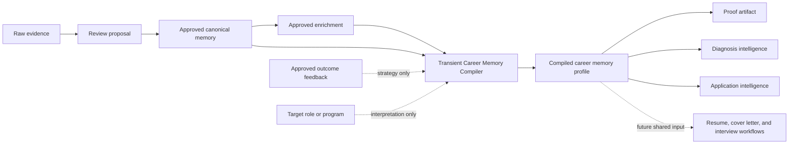

# Career Memory Compiler + Proof Intelligence Fix v13.1

## Status

Sprint 13.1 intelligence patch. This specification extends Sprint 13 Project
Evidence Enrichment and Sprint 12 Proof Artifact Builder without restarting or
replacing either feature.

The implementation guide is
[`../24-Career-Memory-Compiler.md`](../24-Career-Memory-Compiler.md).

## Problem

Sprint 13 established the correct review and identity architecture, but proof
generation can still be too close to a thin resume summary or raw source text.
Approved enrichment may exist without being assembled into a coherent project
profile first. That produces several quality failures:

- supported technical detail is omitted;
- raw project text is placed into the wrong artifact section;
- target-role language is generic or mismatched;
- outcome feedback risks being confused with factual proof;
- separate project memories can be framed too similarly;
- missing evidence is hidden by vague prose; and
- duplicate enrichment attempts do not provide an actionable warning.

## Goal

Compile one selected approved Career Memory and its approved supporting layers
into a rich, inspectable profile before proof generation.

The compiler must answer:

- What is this memory or project really about?
- What is its identity boundary?
- Which evidence supports each claim?
- Which claims are unsafe?
- How is the supported proof relevant to a target role?
- What is missing before the proof is strong enough to submit?

Proof Artifact Builder must use that profile as its primary generation input.
All behavior must work in local deterministic mode without an LLM API key.

## Non-goals

Sprint 13.1 does not:

- create a second persistent source of truth for Career Memory;
- add automatic canonical-memory merging;
- infer unsupported tools, datasets, metrics, findings, or outcomes;
- treat job-description text as evidence;
- treat outcome feedback as proof of skill or causality;
- build a new full resume or cover-letter generator;
- replace the existing diagnosis or application systems; or
- require embeddings, an external model, or an API key.

The compiled contract is consumed by existing diagnosis and application
intelligence for approved project memories without replacing those systems.
Resume and cover-letter builders remain future work; the safe claim ingredients
in this sprint are not a claim that those generators were added.

## Architecture



Compilation is transient. The profile is recomputed from current approved state
for each generation or regeneration. It is not stored as a replacement for the
canonical memory or enrichment review history.

## Compiler service contract

The service lives in `backend/app/services/career_memory_compiler.py`. Its
convenience entry point is equivalent to:

```python
compile_career_memory(
    memory_id,
    target_role=None,
    user_id=None,
    session=None,
) -> CompiledCareerMemoryProfile
```

Callers that already own a session may use
`CareerMemoryCompiler(user_id).compile(session, memory_id, target_role)`. The
selected memory ID and current user remain explicit inputs to the trust check.
No public compiler endpoint is required for Sprint 13.1.

The compiler version is `career-memory-compiler-v1` and is included in the
profile and downstream artifact metadata or structured sections.

## Selected-memory and tenant rules

The selected `memory_id` is authoritative.

The compiler must:

1. load that exact canonical memory within the current-user boundary;
2. verify that the memory's source review proposal is approved;
3. load enrichments only when both `user_id` and `canonical_memory_id` match;
4. include only enrichments whose status is `APPROVED`;
5. resolve evidence only inside the same user and selected-memory provenance;
6. validate outcome feedback inside the same user and selected-memory context;
   and
7. fail safely when the memory is missing, foreign, or not approved.

Title similarity may help identity review before selection. It cannot override
an explicit selected memory ID during compilation.

## Input eligibility

### Factual inputs

Factual compilation may use:

- approved canonical structured fields;
- the selected memory's linked, resolvable evidence;
- `APPROVED` enrichment records attached to that exact memory;
- approved enrichment structured fields; and
- linked, resolvable evidence from those approved enrichments.

### Strategy-only inputs

Approved outcome feedback may be returned as an outcome signal when it is
eligible for the selected memory. It must have its own ID, summary, guidance,
and caveat. It must not be added to factual evidence, `proof_claims`, or source
confidence.

An optional target role or program may guide role relevance, artifact angle,
and reviewer wording. It must not add factual project detail.

### Exclusions

The compiler excludes:

- `PROPOSED`, `REJECTED`, and `ARCHIVED` enrichments;
- duplicate project proposals not approved as enrichment;
- evidence from another memory or user;
- dangling or foreign evidence references;
- proposed or archived feedback events;
- stale diagnosis snapshots when fresher approved feedback is available;
- target-role terms as factual proof; and
- inferred facts without an approved textual basis.

## Evidence categories

`evidence_used` classifies provenance as:

- `CANONICAL_MEMORY`;
- `CANONICAL_EVIDENCE`; or
- `APPROVED_ENRICHMENT`.

Outcome signals are not a fourth evidence kind. They are stored separately in
`outcome_signals` and `outcome_signal_ids_used`.

## Compiled profile schema

`CompiledCareerMemoryProfile` contains:

- `memory_id`
- `canonical_title`
- `memory_type`
- `project_kind`
- `project_boundary`
- `aliases`
- `source_confidence`
- `research_question_or_problem`
- `data_or_inputs`
- `methods`
- `tools`
- `workflow_steps`
- `findings_or_results`
- `limitations`
- `outputs`
- `collaborators_or_context`
- `role_relevance`
- `role_relevance_by_target`
- `skills_demonstrated`
- `proof_claims`
- `resume_bullet_claims`
- `cover_letter_angles`
- `proof_artifact_angles`
- `warnings_not_to_claim`
- `evidence_used`
- `evidence_ids_used`
- `enrichment_ids_used`
- `outcome_signal_ids_used`
- `outcome_signals`
- `missing_or_weak_sections`
- `confidence`
- `target_role_interpretation`
- `compiler_version`

Lists are deduplicated while preserving stable deterministic order. Confidence
is bounded from `0.0` to `1.0`. An absent section stays empty or `null` and is
represented in `missing_or_weak_sections`; it is not filled with generic prose
that implies unsupported evidence.

## Deterministic compiler behavior

The compiler combines explicit structured fields with bounded phrase matching
over approved text. A pattern can normalize wording, but it cannot introduce a
new factual concept that is absent from approved inputs.

Generic projects receive generic, evidence-backed compilation. Gas Kinematics
and UNICORN receive bounded project-specific handling because those memories
otherwise lose important supported detail or become conflated.

### Gas Kinematics pattern

When supported, compile:

- boundary: honors capstone or Gas Kinematics project, separate from UNICORN;
- problem: whether H-alpha gas velocity dispersion relates to galaxy morphology
  or GALFIT axis ratio `b/a` and helps interpret three-dimensional morphology;
- data: CEERS, RUBIES, JWST/NIRSpec spectroscopy, JWST/NIRCam imaging, GALFIT
  axis ratios, spectral data, and imaging data;
- workflow and methods: RA/DEC catalog matching, redshift-guided H-alpha
  identification, Gaussian fitting, nearby `[NII]` components, line-width to
  velocity-dispersion conversion, instrumental-broadening correction,
  uncertainty propagation, covariance errors, S/N filtering, manual inspection,
  quality cuts, `sigma_gas` versus `b/a` plots, and mass-bin comparison;
- results: no clear overall trend, substantial scatter, inconclusive findings,
  or a clearer expected trend in a high-mass bin only when documented;
- limitations: sample size, slit-galaxy misalignment, turbulence, feedback,
  mergers, disturbed gas motion, unresolved high-redshift kinematics, or
  manually questionable fits when documented; and
- outputs: capstone poster, URF poster or presentation, technical report, or
  another explicitly documented deliverable.

Role framing for data science, analytics, and AI may emphasize messy data,
pipeline debugging, statistical modeling, uncertainty, validation, quality
control, and careful communication. It must warn against quantified business
impact, model deployment, a production ML system, or a conclusive trend when
those claims are unsupported.

### UNICORN pattern

When supported, compile:

- boundary: earlier GEVIP image-inspection, categorization, or organization
  project, separate from Gas Kinematics;
- problem: how to organize, inspect, categorize, label, or review astronomical
  imaging and detection data;
- data: astronomical or telescope images, FITS files, inspection plots, and
  source or detection candidates;
- workflow and methods: manual image inspection, detection review,
  categorization, labeling, t-SNE exploration, grouping by visual features,
  identification of spurious detections, hot pixels, noise, or artifacts, and
  technical documentation or proposal review; and
- results: improved review or labeling efficiency and stronger organization only
  when explicitly documented; otherwise the result remains missing or modest.

Role framing for AI Engineer and AI Automation may emphasize dataset quality,
labeling workflow, exploratory representation learning, dataset preparation,
human-in-the-loop review, classification thinking, and model readiness. It must
warn against deployed AI, a trained production model, quantified performance
gain, or Gas Kinematics methods without approved support.

## Identity-boundary acceptance rule

A Gas compilation can use only Gas canonical and approved enrichment records. A
UNICORN compilation can use only UNICORN canonical and approved enrichment
records. Mentioning the other project's name in `project_boundary` is allowed;
borrowing its data, methods, findings, outputs, evidence IDs, or enrichment IDs
is not.

The same rule applies when both memories belong to the same user and share broad
terms such as astronomy, research, imaging, analysis, or GEVIP.

## Safe claims and missing evidence

The compiler distinguishes a safe claim from a useful next question.

Safe output may say:

- no clear trend was found;
- manual inspection was part of quality control; or
- the project demonstrates uncertainty reasoning.

It may not silently add:

- a dataset name that is absent from approved evidence;
- a tool inferred only from the project domain;
- a performance metric;
- business impact;
- deployment;
- causality from an interview or callback; or
- a positive result that contradicts an inconclusive finding.

`missing_or_weak_sections` should use actionable language such as:

- `Need quantified result`
- `Need clearer tool-specific evidence`
- `Need output/link`
- `Need stronger project-specific method evidence`

The warning describes the gap. It does not authorize downstream generation to
fill it.

## Proof Artifact Builder integration

`ProofArtifactService` compiles the selected source memory before deriving the
artifact title, sections, claims, warnings, readiness, and supporting variants.
The compiled profile is the primary content source; thin raw resume text is not
the fallback when richer approved fields exist.

Generation must satisfy these rules:

1. `source_memory_id` equals the compiler's `memory_id`.
2. Gas selection produces a Gas profile and artifact.
3. UNICORN selection produces a UNICORN profile and artifact.
4. Structured fields are converted into clean case-study prose rather than raw
   source dumps.
5. An inconclusive Gas result is framed as careful hypothesis testing, not
   failure and not a successful trend.
6. Outcome signals remain in their own section with a strategy-only caveat.
7. Evidence, enrichment, signal, compiler-version, warning, and missing-section
   provenance remains inspectable.
8. Regeneration recompiles current approved state.

### Gas plus Data Scientist

When approved evidence supports the details, the artifact should communicate:

- a title about testing galaxy morphology with JWST spectroscopy and imaging;
- an H-alpha velocity-dispersion versus morphology problem;
- CEERS/RUBIES, NIRSpec, NIRCam, and GALFIT `b/a` inputs;
- catalog matching, line fitting, corrections, uncertainty, filtering, quality
  review, and `sigma_gas` versus `b/a` analysis;
- no clear overall trend or substantial scatter; and
- proof of messy-data debugging, hypothesis testing, validation, uncertainty,
  and careful communication.

It cannot invent quantified business impact or production deployment.

### UNICORN plus AI Engineer

When approved evidence supports the details, the artifact should communicate:

- a title about image inspection and categorization in UNICORN;
- an imaging/detection organization and review problem;
- image, FITS, plot, or detection-candidate inputs;
- manual inspection, categorization, t-SNE exploration, data-quality review,
  labeling workflow, and technical documentation; and
- human-in-the-loop and model-readiness relevance.

It cannot include Gas Kinematics, H-alpha, GALFIT, CEERS/RUBIES, `sigma_gas`, or
galaxy-morphology methods unless an approved UNICORN enrichment explicitly
supports them. It cannot claim deployment or model-performance metrics without
proof.

## Diagnosis and application integration

Diagnosis compiles each approved project memory for the diagnosis target role
before using its factual text in evidence evaluation and sprint selection.
Application intelligence compiles approved project memories for the opportunity
title when ranking matches, then exposes compiled factual fields and exact
evidence and enrichment provenance in match and draft inputs.

These integrations do not relax the compiler trust model. Approved canonical
facts and approved enrichments may support factual matching and drafting.
Outcome signals remain strategy-only, and the target role or opportunity title
may change interpretation but cannot add project facts. Non-project memories
continue through the existing approved-memory behavior.

## Reviewer questions

Reviewer questions depend on target role and artifact context. They are not a
single analytics fallback.

Examples:

- Gas plus Data Scientist: "Is it clear in the first 30 seconds that this
  project demonstrates data cleaning, modeling, validation, and uncertainty
  reasoning?"
- UNICORN plus AI Engineer: "Is it clear in the first 30 seconds that this
  project demonstrates data-quality and labeling workflow thinking for AI
  systems?"

## Duplicate enrichment contract

The enrichment create operation detects identical saved evidence for the exact
selected memory across active proposed or approved records. It creates no new
row and returns HTTP `409 Conflict`:

```json
{
  "detail": {
    "code": "DUPLICATE_ENRICHMENT",
    "message": "This evidence already appears to be saved for this project. No duplicate enrichment was created.",
    "existing_enrichment_id": "<uuid>",
    "existing_status": "APPROVED"
  }
}
```

The existing enrichment remains unchanged and visible. The frontend must:

- show the exact message next to the enrichment input;
- preserve the pasted input after the `409`;
- keep or highlight the referenced enrichment;
- clear the warning when the user edits the input; and
- clear the warning and input after different evidence is saved successfully.

## Enrichment workspace quality

An approved enrichment card says:

> Approved enrichment used by proof artifacts.

The card presents compact, deterministic summaries for:

- **Memory quality impact**: proof artifact, resume-bullet readiness,
  cover-letter angle, and interview answer;
- **Missing sections**: quantified result, tool-specific evidence, output or
  link, or another compiler-identified gap; and
- **Project boundary**: for example, "This belongs to Gas, not UNICORN" or
  "This belongs to UNICORN, not Gas."

These labels describe reviewed evidence and readiness. They do not imply that a
resume or cover-letter builder was added.

## Stale-preview prevention

The proof workspace treats memory, target role, artifact type, and target
channel as the identity of the current draft request.

If any one changes while a saved artifact is open, the workspace must clear the
active preview or enter a new-draft state with:

> Generate a new artifact for the selected memory.

The saved artifact remains in history. It cannot appear under controls that no
longer match its source memory or generation settings. A response produced for
an older selection must not replace a newer selection if inputs change while a
request is in flight.

## Persistence

The compiler adds no compiled-profile table. Durable sources remain:

- canonical memory and its review decision;
- enrichment review history;
- listening evidence and sources;
- feedback events; and
- saved proof artifacts and versions.

A proof-artifact version is a historical output snapshot. It may store the
compiler version, evidence IDs, enrichment IDs, outcome-signal IDs, warnings,
and structured content needed to inspect how it was produced.

## Backend tests

Required coverage includes:

- Gas compilation includes approved enrichment detail;
- proposed, rejected, and archived enrichment is excluded;
- Gas and UNICORN remain identity-separated;
- linked evidence from another memory is excluded;
- supported Gas terms compile into the expected data, methods, results,
  limitations, and warnings;
- supported UNICORN terms compile into image-review and AI-data-quality framing;
- sparse profiles report missing evidence without invention;
- target-role changes affect interpretation rather than factual provenance;
- approved outcome feedback remains a labeled signal and archived feedback is
  excluded;
- Gas proof generation uses the compiled Gas profile and careful inconclusive
  framing;
- UNICORN proof generation excludes Gas details;
- reviewer questions vary by role and project context;
- diagnosis uses compiled approved-project facts without promoting role framing
  or outcome signals into evidence;
- application ranking and draft inputs expose compiled project facts and
  provenance without admitting unapproved enrichment; and
- approved duplicate enrichment returns the structured `409` and creates no
  additional row.

## Frontend tests

Required coverage includes:

- duplicate API errors preserve code, existing enrichment ID, and status;
- duplicate warning copy renders next to the input;
- duplicate input is preserved;
- editing input clears the warning;
- a different successful save clears warning and input;
- approved enrichment cards show usage, memory-quality impact, missing sections,
  and project boundary;
- changing memory invalidates a stale artifact preview;
- Gas output cannot remain visible under a UNICORN selection;
- target role, artifact type, and channel changes invalidate mismatched preview
  state; and
- the preview displays the reviewer question returned by proof generation rather
  than applying a hard-coded analytics question.

## Acceptance criteria

- Compilation is deterministic, transient, and provider-independent.
- The selected memory and current user define a hard identity boundary.
- Only approved canonical facts and `APPROVED` enrichments support claims.
- Approved outcome feedback is strategy-only and archived feedback is excluded.
- Target-role interpretation never becomes factual evidence.
- Gas artifacts use supported technical depth and careful result framing.
- UNICORN AI artifacts use supported image-review, categorization, t-SNE, and
  data-quality evidence without Gas leakage.
- Missing evidence produces an actionable gap or warning instead of invention.
- Duplicate enrichment attempts return the structured `409`, preserve input,
  and point to the existing record.
- Changing proof inputs cannot display a stale artifact as the current draft.
- Diagnosis and application intelligence consume the compiled profile for
  approved project memories under the same identity and evidence boundary.
- No LLM API key is required.
- No full resume or cover-letter generator is added.

## Limitations and follow-ups

- Deterministic pattern coverage is intentionally bounded and will not understand
  every project domain.
- OCR, figure interpretation, and table reconstruction remain separate work.
- The compiler does not resolve ambiguous multi-memory merges automatically.
- Outcome signals remain sparse and non-causal.
- Diagnosis and application intelligence currently compile approved project
  memories; any expansion to other memory types must preserve the same
  provenance and regression guarantees.
- Future resume and cover-letter builders may consume safe claim ingredients but
  must preserve the same approval, evidence, identity, and warning boundaries.
