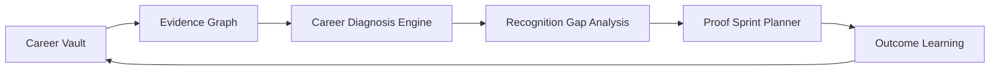

# CareerOS North Star

## Status

Directional product and architecture north star for post-MVP intelligence. It
defines the narrow advantage CareerOS should compound toward; it is not a
claim that every capability below exists today.

## Problem

Generic resume generators and cover-letter wrappers optimize wording without
understanding the student’s actual career position. They can produce polished
documents while leaving the central questions unanswered:

- What can this student prove?
- What will another person likely recognize?
- What proof is missing?
- Which strategies have worked before?
- What action would most improve the trajectory next?

Overlooked students need judgment, not more generic content.

## Goal

CareerOS is not a generic resume generator or cover letter wrapper.

CareerOS is a career judgment system.

It should help students understand:

- what they can prove;
- what others are likely to recognize;
- what proof is missing;
- what strategies have worked before;
- what action would most improve their trajectory next.

CareerOS should not try to be smarter than ChatGPT at everything. It should be
smarter than generic tools at one narrow thing: career diagnosis for overlooked
students.

## User flow

1. **Listen**: collect resumes, transcripts, projects, applications, letters,
   outcomes, constraints, goals, and feedback.
2. **Approve**: extract evidence and let the user shape it into canonical
   Career Memory.
3. **Map**: connect experiences, skills, claims, proof, validators, target
   opportunities, and outcomes.
4. **Diagnose**: compare the student’s desired direction with their proof and
   likely recognition.
5. **Sprint**: recommend one high-leverage proof action for the next seven
   days.
6. **Learn**: record what happened and what the user learned about framing,
   strategy, and outcomes.
7. **Repeat**: update the diagnosis when new evidence or feedback changes the
   situation.

## Core concepts

### 1. Career Vault

The Career Vault is the durable personal source of truth. It stores resumes,
transcripts, projects, applications, cover letters, recommendation letters,
outcomes, constraints, goals, and feedback. It preserves both current
canonical knowledge and historical artifacts so later learning cannot rewrite
what was previously submitted.

### 2. Evidence Graph

The Evidence Graph maps:

`Experience → Skills → Claims → Proof → Validators → Target Opportunities → Outcomes`

It makes the chain behind a recommendation inspectable. A claim may have
multiple proof items; a proof item may support multiple target opportunities;
an outcome is attached to what actually happened, not retroactively inferred.

### 3. Career Diagnosis Engine

The engine diagnoses why a student is stuck or under-recognized. It should
separate at least these possibilities:

- strong ability but weak or inaccessible proof;
- proof exists but is framed for the wrong audience;
- target is mismatched to current evidence;
- claim is plausible but lacks a validator or outcome;
- application strategy is inconsistent with prior feedback;
- the student needs a new artifact, not another rewrite.

Sprint 11 defines the first version of this engine in
`11-Career-Diagnosis-Engine-v0.md`.

### 4. Recognition Gap Analysis

Recognition Gap Analysis compares three views:

- what the user wants;
- what the user can prove;
- what employers or evaluators are likely to recognize.

The gap is a product insight, not a deficit label. It should identify the
smallest change in proof, framing, target, or validator that could improve
recognition.

### 5. Proof Sprint Planner

The planner recommends one high-leverage next action, not generic advice. A
proof sprint should have a target, definition of done, artifact or validator,
seven-day sequence, and a reason it is more valuable than other available
work.

### 6. Outcome Learning

Outcome Learning tracks what happened after applications, outreach, drafts,
projects, and recommendations. It keeps user feedback and observed outcomes
connected to the strategy and proof that preceded them. Full analytics can
come later; the architecture must preserve the links now.

## Data model / backend behavior

The architecture is layered:

- Universal Listening and evidence extraction create source observations.
- Review Persistence stores proposals and decisions.
- Canonical Career Memory stores approved current knowledge.
- Applications and artifacts preserve opportunity context and historical
  outputs.
- Feedback and outcomes are append-only learning inputs where possible.
- The Evidence Graph stores explicit edges with provenance and confidence.
- Diagnosis runs reference inputs and evidence; they do not silently mutate
  canonical memory.

The system must maintain a strict distinction between:

1. current approved facts;
2. historical submitted artifacts;
3. user feedback and observed outcomes;
4. derived diagnosis and recommendations.

Every recommendation should be able to point back to the graph edges, memory
records, feedback notes, or outcome events that support it. Avoid storing
hidden chain-of-thought. Store concise reason codes, evidence references,
prompt/provider version when relevant, and user-visible summaries.

## Frontend behavior

CareerOS should feel like a calm professional memory studio, not a generic AI
chat. The interface should make evidence, approval, recognition, and next
action visible in that order.

Preferred language includes “approved memory,” “evidence trail,” “story
ingredients,” “application fit map,” “draft from approved memory,” and
“supporting evidence saved.” Avoid unsupported certainty, cute/game-like
language, fear-heavy gap labels, and opaque “AI says” explanations.

The long-term diagnosis surface should make it easy to answer:

- What is my strongest current identity?
- Show me the proof.
- What is not being recognized yet?
- What should I do this week?
- What happened last time, and what did CareerOS learn?

## Product rules

- Trust is a feature: evidence and provenance are always inspectable.
- Human approval remains the gate for important canonical facts and actions.
- CareerOS should prefer a narrow, accurate diagnosis over broad, impressive
  advice.
- Recommendations must be actionable, prioritized, and proportionate to the
  evidence.
- Outcomes must be recorded without rewriting historical truth.
- Feedback belongs to the user and may correct CareerOS’s framing.
- The product should help overlooked students become more recognizable without
  asking them to exaggerate or perform a false identity.
- The system should say “not enough evidence yet” when that is the honest
  answer.

## Known limitations

- The full Evidence Graph and Outcome Learning systems are not implemented.
- Current matching and drafting are deterministic and narrow.
- Recognition likelihood will remain uncertain until CareerOS has enough
  target-specific feedback and outcomes.
- Career advice is contextual; a diagnosis is not a guarantee of hiring,
  admission, or any other result.
- Privacy, consent, retention, and deletion rules must mature before broad
  ingestion of sensitive letters, outcomes, and feedback.

## Future follow-ups

- Ship Career Diagnosis Engine v0 as the next intelligence slice.
- Add graph-backed validators and target opportunity edges.
- Add application, outreach, project, recommendation, and interview outcome
  events with immutable historical context.
- Learn from user-provided feedback without treating correlation as causation.
- Measure whether proof sprints improve recognition, response rates, interviews,
  or other user-defined outcomes.
- Make the architecture exportable, privacy-aware, and portable across
  providers and future integrations.
